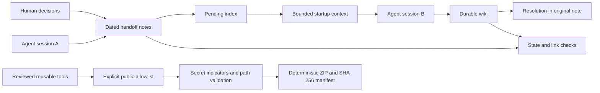

# A second brain that survives the end of a chat

The interesting unit is not a prompt. It is a handoff with a source, a status,
and an explicit boundary between decisions and observations.

## One source across sessions

A human or agent owns a handoff file. Another session can use the same files,
regardless of editor or AI provider. There is no duplicate memory database to
synchronize. Persistent wiki content and temporary handoffs have different roles.

## Evidence is separate from authority

A useful finding does not become an instruction merely because an agent wrote
it down. `Decisions` records explicit choices; `Verified` records observations;
`Limits` records what remains unknown. The software does not execute any note.

## Closure has a destination

A note marked incorporated without a resolution stays in the pending list. A
state quoted in the body cannot close the header. These checks address two real
failure modes in long-running agent work: premature closure and mistaken authority.

## Context is finite; pending work is not

The context command includes whole notes until its budget is exhausted. It
reports both included and matching counts. A note omitted from context remains
pending. Character budgets are deliberately transparent; they are not token estimates.

## Public tools and private memory are separate artifacts

Public releases start from an explicit file list, not a copy of the vault or a
Git-history rewrite. Release validation happens before the archive is created.
Hashes let a reviewer verify exactly which bytes were shared. This still requires
human review: no scanner can infer every private fact or license restriction.

## Scope of this release

This repository implements indexing, handoffs, context, checks and release
packaging. It does not implement an autonomous agent platform, model inference,
vector search, edit locks or Git synchronization. Those are possible integrations,
not capabilities claimed by this version.
